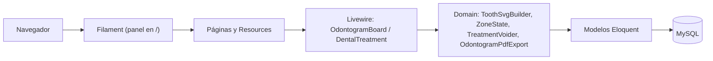
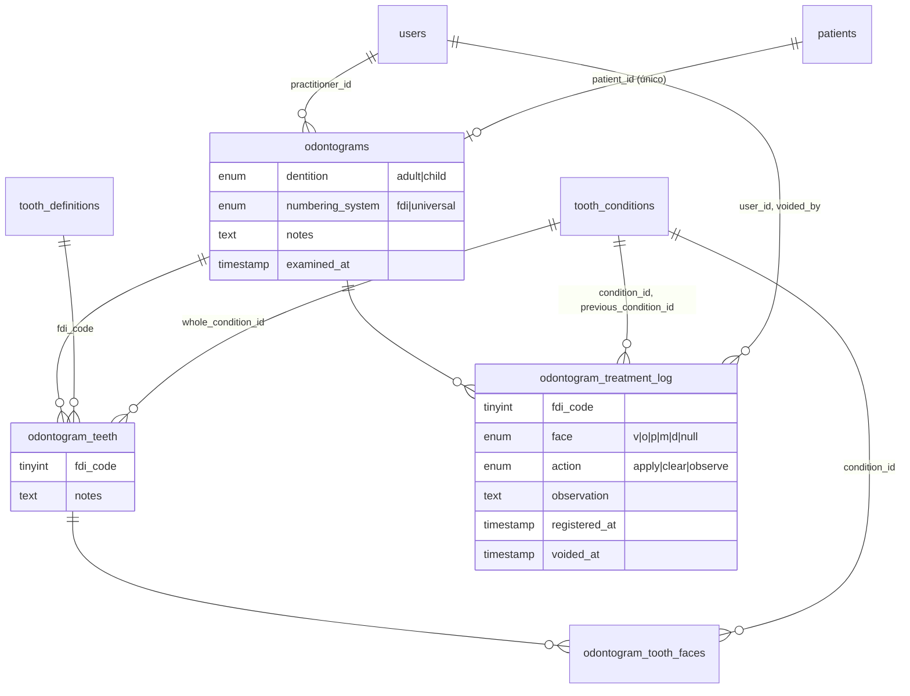

# Odonto360 🦷

<a href="https://www.instagram.com/amvsoft.tech/">
  
</a>

Sistema de odontograma dental construido con **Laravel 13**, **Filament v5**, **Livewire v4** y **Tailwind v4**. Permite a los odontólogos registrar el estado dental de cada paciente en un tablero interactivo con SVG, llevar una bitácora auditable de tratamientos y exportar el resultado a PDF.


---

## Tabla de contenidos

1. [Características](#características)
2. [Requisitos](#requisitos)
3. [Inicio rápido](#inicio-rápido)
4. [Configuración](#configuración)
5. [Cómo se usa](#cómo-se-usa)
6. [Reglas de negocio](#reglas-de-negocio)
7. [Arquitectura](#arquitectura)
8. [Modelo de datos](#modelo-de-datos)
9. [Login animado](#login-animado)
10. [Pruebas y calidad](#pruebas-y-calidad)
11. [Despliegue](#despliegue)
12. [Solución de problemas](#solución-de-problemas)
13. [Contribuir](#contribuir)
14. [Hoja de ruta](#hoja-de-ruta-propuesta)

---

## Características

- **Tablero interactivo** con 32 piezas adultas o 20 infantiles, por cara (vestibular, oclusal/incisal, palatina/lingual, mesial y distal) o pieza completa. Numeración **FDI** o **Universal**.
- **Guardado diferido**: las marcas se acumulan como cambios pendientes y se persisten juntas, en una transacción, al pulsar *Guardar* (con *Deshacer* y *Descartar*).
- **Bitácora de tratamientos** con quién, cuándo, qué condición y observación. Nunca se borra: un error se **anula** y la zona vuelve a su estado anterior.
- **Notas** por pieza y generales del examen, **hallazgos** calculados en vivo y **exportación a PDF** (A4 horizontal, con paginación).
- **Reglas por edad**: dentición adulta para mayores de 18 años, infantil para menores de 6.
- **Panel de administración** (pacientes, odontólogos, condiciones y definiciones dentales) con búsqueda global.
- **Login animado** con una mascota Rive que reacciona al correo, la contraseña y el resultado.

## Requisitos

| Herramienta | Versión |
|-------------|---------|
| PHP | **8.4+** (lo exige `dragonofmercy/phppdf`), con las extensiones habituales de Laravel (`mbstring`, `xml`, `curl`, `zip`, `intl`, `bcmath`) más `pdo_mysql` y, para los tests, `pdo_sqlite` |
| Composer | 2.x |
| Node.js | 22 LTS (probado con 22.x) |
| Base de datos | MySQL 8; SQLite en memoria para los tests |

> **Varios PHP en el mismo servidor:** invoca explícitamente la versión correcta, por ejemplo `php8.4 artisan …` y `php8.4 $(which composer) …`. `composer run dev`, `composer run setup` y `composer test` usan el `php` por defecto del sistema.

## Inicio rápido

```bash
git clone https://github.com/phpeitor/odonto360.git
cd odonto360

composer install
npm install
cp .env.example .env
php artisan key:generate

# Crea la base de datos y ajusta DB_* en .env (ver «Configuración»)
php artisan migrate --seed
npm run build

composer run dev            # servidor + Vite en desarrollo
```

`composer run setup` automatiza la instalación (dependencias, `.env`, clave, migraciones y build), pero no ejecuta los seeders.

**Usuario de prueba** (creado por `DatabaseSeeder`): `test@example.com` / `password`.

> Los seeders son parte del sistema, no solo datos de ejemplo: `ToothDefinitionSeeder` (52 piezas) y `ToothConditionSeeder` (condiciones clínicas) deben ejecutarse o el tablero no dibuja nada.

## Configuración

Variables relevantes de `.env`:

| Variable | Descripción |
|----------|-------------|
| `APP_URL` | URL pública; la usan los enlaces y los assets. |
| `DB_CONNECTION`, `DB_HOST`, `DB_PORT`, `DB_DATABASE`, `DB_USERNAME`, `DB_PASSWORD` | Conexión a MySQL. Con autenticación por socket (`auth_socket`) usa `DB_HOST=localhost` y `DB_SOCKET`. |
| `UBUNTUX_API_URL` | *Opcional.* Servicio de consulta de personas por documento; autocompleta los datos al crear pacientes y odontólogos. Si no se define, el formulario funciona sin autocompletar. |
| `SESSION_DRIVER`, `CACHE_STORE`, `QUEUE_CONNECTION` | Por defecto `database`: las tablas las crean las migraciones. |

Ejemplo mínimo para MySQL local:

```dotenv
DB_CONNECTION=mysql
DB_HOST=127.0.0.1
DB_PORT=3306
DB_DATABASE=odonto360
DB_USERNAME=odonto
DB_PASSWORD=secreto
```

## Cómo se usa

1. **Pacientes**: crea o edita al paciente. La fecha de nacimiento determina qué dentición está permitida.
2. **Odontograma**: elige al paciente y al odontólogo, selecciona una condición de la paleta y haz clic en una cara o en el número de la pieza.
   - *Sano / Borrar* limpia una zona.
   - Volver a marcar una zona ya tratada abre un modal para registrar una **observación**.
   - *Guardar* persiste los cambios y avisa con un aviso emergente.
3. **Pacientes → Tratamientos dentales**: historial del paciente. **Anular** revierte un tratamiento registrado por error.
4. **Exportar PDF** desde el tablero: encabezado del paciente, odontograma, leyenda, hallazgos, historial, notas por pieza y notas generales.

## Reglas de negocio

- **Un odontograma por paciente.** Es el estado actual; cada tratamiento se registra sobre él (`odontograms.patient_id` es único).
- **Estado frente a bitácora.** Las tablas `odontogram_teeth` / `odontogram_tooth_faces` guardan el *estado actual*; `odontogram_treatment_log` guarda *lo que pasó*. Son complementarias: borrar filas de la bitácora **no** cambia el estado, por eso la bitácora no se elimina.
- **Anular con reversa** (`TreatmentVoider`):
  - Cada cambio guarda su acción (`apply`, `clear` u `observe`) y la condición previa.
  - Anular marca el registro (`voided_at`, `voided_by`) y devuelve la zona a su estado previo.
  - Solo se puede anular el **último** cambio vigente de cada zona; los anteriores, del más reciente al más antiguo.
  - Los registros anteriores a este control se reconstruyeron con `TreatmentLogBackfill` cuando el historial lo permitía.
- **Dentición según la edad** (`Patient::allowsDentition()`): ≥ 18 años solo adulta; < 6 años solo infantil; entre 6 y 17, ambas. Sin fecha de nacimiento no se restringe. Además del botón deshabilitado, el servidor rechaza el cambio.
- **Las 52 definiciones dentales son fijas**: se editan solo los campos de anatomía y visualización; no se crean ni se borran.
- **Los textos se sobrescriben**: las notas (generales y por pieza) no tienen historial.

## Arquitectura



```
app/
├── Domain/Odontogram/   Lógica de dominio (SVG, numeración, estado de zonas, anulación, PDF)
├── Enum/                PatientSex
├── Filament/
│   ├── Pages/           OdontogramBoard y Auth/Login
│   └── Resources/       Patients, Users, ToothConditions, ToothDefinitions (patrón Schemas/ + Tables/)
├── Http/Controllers/    OdontogramPdfController (única ruta web: el PDF)
├── Livewire/            OdontogramBoard (tablero), DentalTreatment (historial)
├── Models/
├── Providers/Filament/  AdminPanelProvider
└── Services/            UbuntuxPatientLookup
resources/
├── css/filament/admin/theme.css   Tema y paleta de los dientes
├── js/login-rive.js               Mascota del login
└── views/                         Blade (livewire/, filament/, vendor/ sobrescritas)
```

Decisiones a tener presentes:

- **Todo es un panel de Filament montado en `/`.** `routes/web.php` solo define la ruta del PDF; las pantallas nuevas son Pages o Resources, no rutas web.
- **El SVG de cada pieza se genera en el servidor** (`ToothSvgBuilder`) y se interactúa con Alpine (`@click="$wire.selectZone(...)"`). No uses `wire:click` sobre elementos SVG: no se inicializan de forma fiable en Livewire v4.
- **Los códigos de condición están acoplados** (`sano`, `caries`, `corona`, `endodoncia`, …) entre los seeders y el SVG. No renombres un código sin actualizar ambos.
- **El tema CSS define la paleta** de los dientes (`--ink`, `--surface-alt`, `--border`). Los cambios de CSS o vistas requieren `npm run build`.
- **Vistas de Filament sobrescritas**: `resources/views/vendor/filament-panels/livewire/topbar.blade.php` añade tooltips a los botones del menú. Revísala al actualizar Filament.

## Modelo de datos



- Caras: `v` vestibular, `o` oclusal/incisal, `p` palatina/lingual, `m` mesial, `d` distal; `null` = pieza completa.
- Códigos FDI: 11–48 (adultos) y 51–85 (infantiles).

## Login animado

`public/images/login.riv` es una animación [Rive](https://rive.app) controlada por la state machine **`State Machine 1`**:

| Input | Tipo | Uso |
|-------|------|-----|
| `Check` | booleano | El diente mira el campo del correo. |
| `Look` | número (0–100) | Dirección de la mirada según lo escrito. |
| `hands_up` | booleano | Se tapa los ojos al enfocar la contraseña. |
| `success` | trigger | Sonrisa; el navegador redirige tras 1,5 s. |
| `fail` | trigger | Cara de preocupación ante credenciales incorrectas. |

`App\Filament\Pages\Auth\Login` avisa al navegador con los eventos `login-succeeded` y `login-failed`; `resources/js/login-rive.js` los traduce a los inputs. El runtime (`@rive-app/canvas`) y su `.wasm` se empaquetan con Vite, sin CDN. Si el `.riv` no carga, la mascota se oculta y el login sigue funcionando; con *reducir movimiento* activado se omiten las reacciones.

> Para cambiar la mascota, reemplaza el `.riv` conservando el nombre de la state machine y de los inputs.

## Pruebas y calidad

```bash
composer test                                 # config:clear + php artisan test
php artisan test --compact --filter=Treatment # un subconjunto
vendor/bin/pint --dirty                       # formato del código modificado
```

- Las pruebas usan **Pest** con SQLite en memoria; no necesitan base de datos.
- Cada cambio debe acompañarse de su prueba. Las de Livewire y Filament siguen el patrón de `tests/Feature/OdontogramPageTest.php`.
- Formatea con **Pint** antes de hacer commit.

## Despliegue

```bash
composer install --no-dev --optimize-autoloader
npm ci && npm run build
php artisan migrate --force
php artisan optimize
```

- Sirve `public/` con Nginx + PHP-FPM 8.4. El usuario de PHP-FPM (`www-data`) necesita credenciales MySQL propias: la autenticación por socket de `root` solo funciona para el usuario `root` del sistema.
- Configura Nginx para entregar `.wasm` como `application/wasm`; si no, Rive usa un modo de respaldo más lento.
- Asegura `APP_ENV=production` y `APP_DEBUG=false`, y publica solo por HTTPS.
- Las migraciones de datos (por ejemplo `backfill_treatment_log_actions`) corren con `migrate`; haz copia de seguridad antes de aplicarlas en producción.

## Solución de problemas

| Síntoma | Causa y solución |
|---------|------------------|
| `Unable to locate file in Vite manifest` | Falta el build: `npm run build` (o `composer run dev`). |
| El tablero sale vacío | Faltan los seeders: `php artisan db:seed --class=ToothDefinitionSeeder` y `--class=ToothConditionSeeder`. |
| `composer install` pide PHP 8.4 | Estás usando otra versión de PHP; ejecuta con `php8.4`. |
| `Access denied for user 'root'` por TCP | MySQL usa `auth_socket`: crea un usuario dedicado o conecta por socket. |
| Los tests fallan con `could not find driver` | Falta la extensión `pdo_sqlite` de PHP. |
| Un cambio de CSS o de una vista no se ve | Recompila con `npm run build` y limpia vistas con `php artisan optimize:clear`. |

## Contribuir

1. Crea una rama desde `main`: `feat/…` o `fix/…`.
2. Haz commits pequeños y descriptivos (estilo `feat: …`, `fix: …`).
3. Ejecuta `vendor/bin/pint --dirty` y las pruebas.
4. Abre un Pull Request describiendo el cambio, las migraciones necesarias y cualquier dependencia nueva.

Las convenciones del proyecto para agentes y asistentes de código están en `AGENTS.md` y `.ai/rules/`.

## Hoja de ruta (propuesta)

- **Historial de exámenes**: una entidad de examen (fecha, odontólogo, notas) vinculada a los cambios de la bitácora, para listar exámenes y generar el PDF de una fecha pasada.
- Historial de las notas por pieza y de las notas generales.
